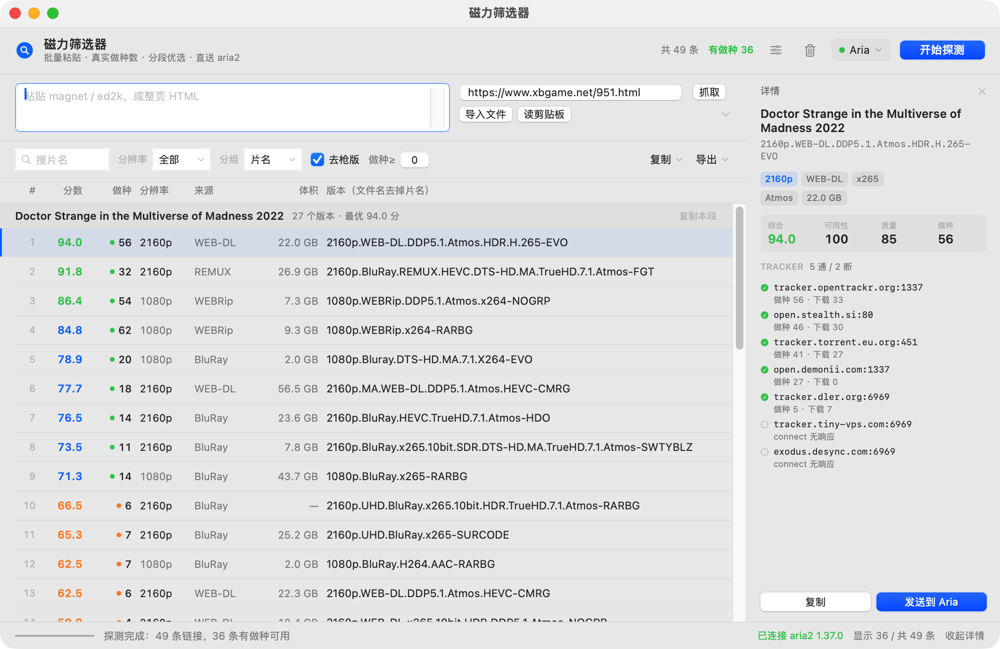
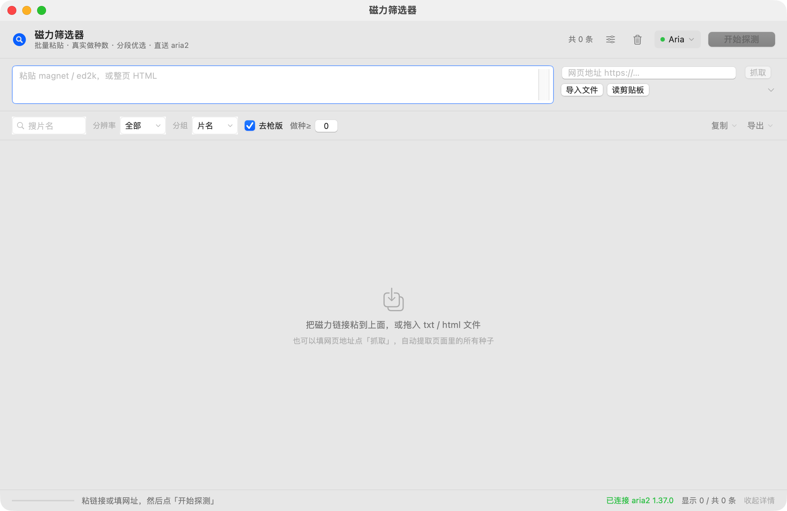

# 磁力筛选器 · MagnetPicker

把一堆 magnet / ed2k 链接丢进来，它先探测**每条链接的真实做种数**，再按**片源质量**打分，最后告诉你哪条线路值得下 —— 并且可以一键送到 aria2 开始下载。

原生 SwiftUI，单文件 App，纯本地运行：不需要 Python、不需要 libtorrent、不上传任何东西。



## 它解决什么问题

同一个电影，网上往往挂着几十条种子：4K REMUX 做种 3，1080p WEB-DL 做种 60，还有个枪版做种 100。
只看"做种最多"会下到枪版，只看"画质最好"又可能下不动。这个工具把两件事一起算：

- **能不能下**：向 tracker 发 scrape（只读），拿做种数 / 下载人数
- **值不值得下**：从文件名读分辨率、来源、编码、音轨、体积合理性，给片源质量打分

## 功能

- **批量粘贴**：magnet、ed2k、整页 HTML 一起丢进粘贴框，自动去重合并同一 hash 的多个 tracker
- **网页抓链接**：填一个网页地址点「抓取」，把页面里所有种子提出来，并从锚文本补齐体积
- **真实做种数**：tracker scrape 优先，announce 兜底（`numwant=0`，不占 peer 名额），完全没有 tracker 时才用 DHT
- **自动筛选排序**：综合分 = 可用性 × 权重 + 片源质量 × (1-权重)，枪版直接降权
- **分段**：按片名 / 按分辨率分组，每段显示版本数与最优分
- **批量复制 / 导出**：复制全部优选、前 N，或导出 txt / JSON（磁力已合并全部 tracker）
- **发送到 aria2**：选中 / 前 5 / 全部优选，一条 RPC 一棵任务，可直接开始下载
- **扁平界面**：单层底色 + 1px 分隔线，无阴影无渐变，窗口最小 1040×640
- **省资源**：包 2.3 MB，release 二进制约 1.6 MB；探测完 49 条链接后常驻约 100 MB、CPU 归零

| 空状态 | 详情面板 |
| --- | --- |
|  | 点任意一行，右侧滑出该条的全部 tracker 明细与评分拆解 |

## 安装

要求 macOS 13 或更新（Apple Silicon / Intel 均可）。

**方式一：自己构建（推荐，能拿到最新代码）**

```bash
git clone https://github.com/Xananr/magnet-picker.git
cd magnet-picker
./build-app.sh --install # 编译 release + 组 bundle + 生成图标 + ad-hoc 签名 + 装进 /Applications
# 从「应用程序」里打开「磁力筛选器」，或直接 open /Applications/磁力筛选器.app
```

只需要 Xcode 命令行工具（`xcode-select --install`），没有第三方依赖。

**方式二：下载 Release 里的 zip**，解压后拖进「应用程序」。首次打开若被 Gatekeeper 拦：

```bash
xattr -dr com.apple.quarantine /Applications/磁力筛选器.app
```

## 配置 aria2

App 只负责发 JSON-RPC，aria2 需要你自己跑起来（本机或 NAS 都行）：

```bash
# 本机（只监听本地，最省心）
aria2c --enable-rpc --rpc-listen-port=6800 --rpc-secret=你的密钥

# 需要从别的机器连（比如路由器 / NAS 上跑）
aria2c --enable-rpc --rpc-listen-all=true --rpc-secret=你的密钥 --dir=/volume1/downloads
```

然后在 App 顶栏 `Aria ▾ → 连接设置…` 里填：

| 字段 | 例子 | 说明 |
| --- | --- | --- |
| RPC 地址 | `http://127.0.0.1:6800/jsonrpc` | 远端就填对应 IP，端口后面别漏 `/jsonrpc` |
| RPC 密钥 | `你的密钥` | 对应 `--rpc-secret`，留空表示不鉴权 |
| 保存目录 | `/volume1/downloads` | 留空用 aria2 自己的 `--dir` |

填完点「保存」或「测试连接」，顶栏的圆点变绿就表示通了。之后：

- 顶栏 `Aria ▾ → 发送全部优选 / 前 5 条 / 当前选中`
- 详情面板右下角「发送到 Aria」
- 行右键菜单「发送这条到 Aria」

发送用的磁力已经合并了全部 tracker，不会出现"只有一半 tracker 的种子下不动"。

## 用法

1. 粘贴链接（或拖入 `.txt` / `.html`，或点「读剪贴板」）
2. 想抓网页就填地址点「抓取」
3. 点「开始探测」，等进度条走完（49 条链接约 70 秒，命中缓存基本秒出）
4. 看表格：`分数` 降序，`做种` 是多个 tracker 里的最大值，`版本` 列是去掉片名后的关键信息
5. 点一行看详情，确认后「复制」或「发送到 Aria」
6. 筛选栏可以按分辨率过滤、按片名/分辨率分组、剔除枪版、设最低做种

快捷键：`⌘R` 重新探测、`⌘.` 停止、`⇧⌘C` 复制全部优选、`⇧⌘D` 发送全部优选到 Aria。

## 评分口径

**可用性**（0~100）：`min(1, log10(1+做种) / log10(51)) × 100`，即 50 做种就接近满分，用对数避免"做种 1000 的种子碾压一切"。

**片源质量**（0~100）：分辨率、来源（REMUX > BluRay > WEB-DL > WEBRip > HDRip）、编码、音轨、HDR、体积是否落在该分辨率的常见区间；合集 -4、3D -8。

**综合分** = 可用性 × 权重（默认 0.6）+ 质量 × 0.4；枪版 CAM/TS 质量先 -30，综合分再乘 0.35，所以枪版做种再多也挤不进推荐。

## 已知边界

- **PT 私有站**需要 passkey 才能 scrape，公网 tracker 探不到，会显示 0 做种，这是正常现象
- **ed2k** 只解析并参与质量评分，源数标"未知"不参与排序（eD2K 服务器网络已基本废弃，真实源数要走 Kad，不启动 aMule/迅雷拿不到）
- 开着 TUN 代理（Clash / Surge 等）时 UDP 常被规则拦掉，UDP tracker 与 DHT 会大面积失败；让 App 走直连，或把 tracker 换成 HTTP 的
- 探测是纯只读：不加入任何下载队列、不修改种子文件，只有你点「发送到 Aria」才会真的建任务
- 缓存位于 `~/Library/Caches/MagnetPicker/probe-cache.json`，默认 6 小时；删掉即强制重新探测

## 目录结构

```
Sources/MagnetPicker/
  App.swift            入口、启动参数、菜单命令
  Models.swift         条目、筛选条件、探测参数、格式化
  Parser.swift         magnet / ed2k / HTML 抽取、体积补齐、base32
  ReleaseParsing.swift 片源解析与质量分
  Bencode.swift        bencode 解码 + DHT 报文编码
  Engine.swift         网页抓取、HTTP/UDP tracker scrape 与 announce
  DHT.swift            极简 get_peers 嗅探（兜底用）
  ProbeEngine.swift    探测调度、缓存、收尾评分
  Aria2Client.swift    aria2 JSON-RPC（addUri / getVersion / getGlobalStat）
  AppModel.swift       状态、解析合并、探测批处理、复制导出、发送
  ContentView.swift    扁平界面
  SelfTest.swift       --selftest 无 UI 自检
Resources/AppIcon.png  图标源图（1024×1024）
build-app.sh           打包脚本
docs/                  截图与设计说明
```

## 自检

```bash
./build/MagnetPicker.app/Contents/MacOS/MagnetPicker --selftest
```

会跑解析、合并、评分、磁力重建、aria2 请求体、网页体积、真实探测七组断言。

## License

MIT
